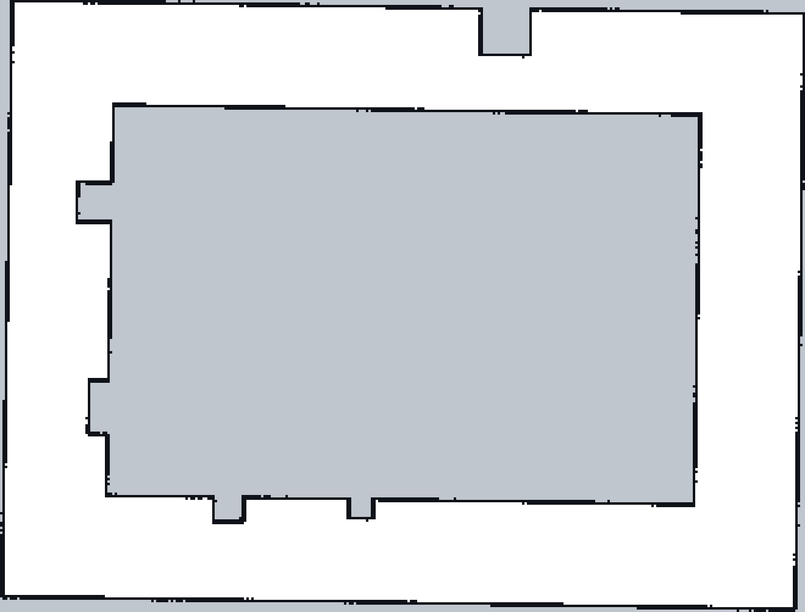
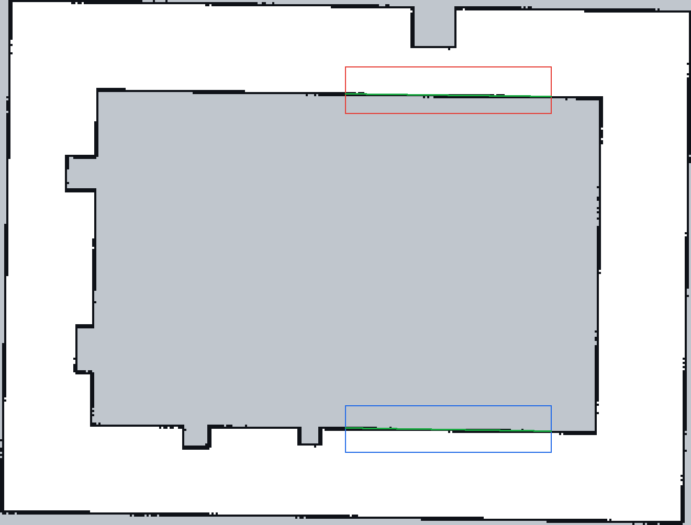
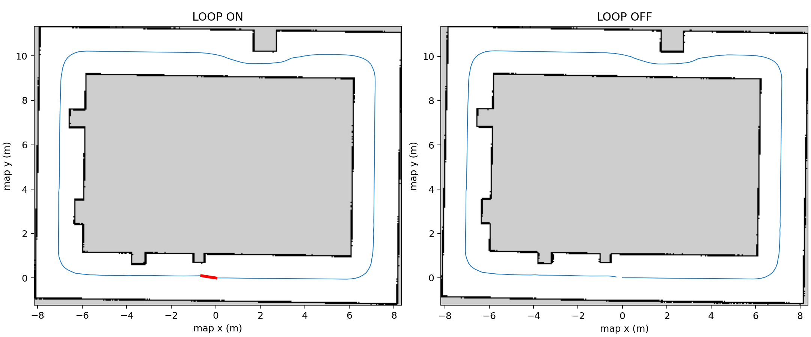
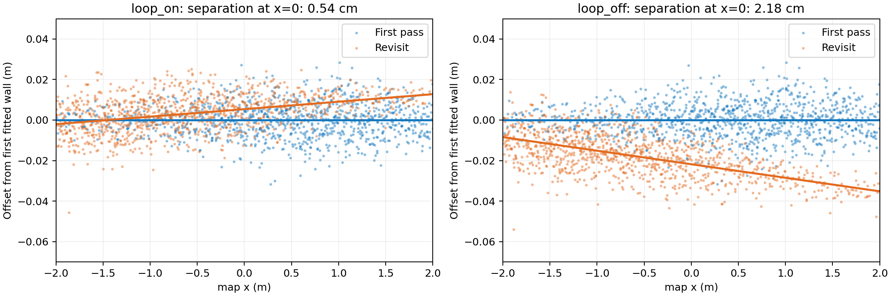
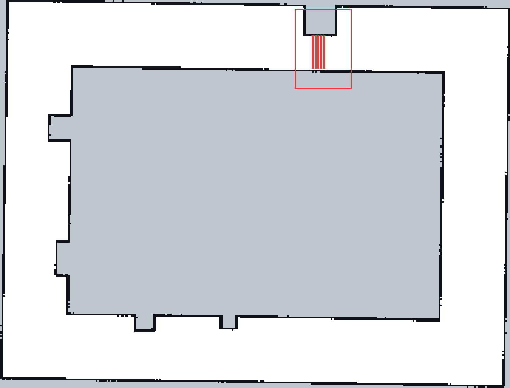

# M3-2 SLAM 地图质量报告

## 1. 场景与难点

自建 `worlds/scene.world`：东侧走廊长 8 m、净宽 2.1 m，中央障碍四周构成回环；北侧设置净宽 1.15 m 的局部窄通道。

难点用于检验遮挡、低速转向时的扫描匹配与栅格化后通行宽度。预期可能出现墙面增厚、错位或通道收窄。实测窄通道连续自由宽度为 1.10 m，保持连通，未出现堵塞；比设计宽度少 0.05 m，相当于一个栅格，不能直接归因于 SLAM 漂移。

## 2. 数据与配置

原始数据：`bags/m3_2_full_run_20261010_044458/`，时长 430.33 s，含 4280 帧 `/scan`、21401 帧 `/odom` 及 `/tf`、`/tf_static`、`/clock`。巡场直行 0.16 m/s，转弯及窄通道 0.08 m/s。

本次在同一 rosbag 上分别开启、关闭回环重建地图。两组均采用 `sync_slam_toolbox_node`、2 倍速回放；移除旧 `/map`、`/cmd_vel` 和 21517 个旧 `map→odom` 变换，保留录制的 `/clock`。建图输入不含 Gazebo 真值。

| 参数 | 设置与依据 |
|---|---|
| `resolution` | 0.05 m；1.15 m 窄通道约 23 格、0.30 m 车宽约 6 格，兼顾通行空间表达与地图规模 |
| `min_laser_range` / `max_laser_range` | 0.12 / 7.8 m，匹配雷达 0.12～8.0 m 有效量程 |
| `minimum_time_interval` | 0.1 s，匹配实测约 10 Hz 的扫描频率 |
| `minimum_travel_distance` / `minimum_travel_heading` | 0.10 m / 0.10 rad，减少高度重复的后端节点 |
| `loop_search_maximum_distance` | 3.0 m，在返回起点区域时搜索历史扫描 |
| `do_loop_closing` | 正式地图 `true`，对照组 `false`；其余运行参数一致 |
| 地图加载阈值 | `free_thresh=0.25`、`occupied_thresh=0.65`，与 SLAM 内部占据阈值分开设置 |

雷达为 `lidar_link`、360 束近全周扫描，测距噪声标准差 0.01 m。直行每帧位移约 0.016 m，转弯约 0.008 m，均小于 0.05 m 栅格；后端仍会按移动门槛筛选扫描。

## 3. 正式地图

`maps/map.pgm`、`maps/map.yaml` 使用本次回环开启结果，与 `maps/map_with_loop_on.pgm` 相同；旧地图保留在 `maps/archive/`。

- 尺寸：330 × 251 像素，覆盖 16.50 × 12.55 m。
- 自由 / 占据 / 未知栅格：38348 / 3099 / 41383。
- 两组 PGM/YAML 均通过真实 Nav2 `map_server` 的 `LoadMap` 服务加载，返回码 0。



## 4. 墙体直线度

在中央北、南长墙各采样 99 列、长度 4.90 m，提取墙线中点并拟合直线，计算点到直线的垂直距离。

| 墙段 | 平均绝对偏差 | 最大绝对偏差 |
|---|---:|---:|
| 中央北墙 | 0.0064 m | 0.0151 m |
| 中央南墙 | 0.0062 m | 0.0167 m |

两段 ROI 的分离墙带筛查均为 0 列（检测条件为墙带边缘相隔至少 3 像素）。偏差相对于地图拟合线，不代表真实定位精度。



## 5. 回环一致性与单参数对照

两组后端均保留 246 个节点，节点扫描时间戳逐项一致。开启回环时有 246 条边，包含起点 0 与近终点 243 的跨圈约束；关闭时为 245 条边，无该约束。

选南侧外墙同一段，在 SLAM 坐标 ROI `x∈[-2,2] m、y∈[-1.5,-0.5] m` 内，分别拟合首次经过（仿真时间 26.698～48.998 s）与重访（415.303～426.103 s）的扫描点。以首次墙线法向为基准，测量 `x=0` 截面间距，并计算整个 4 m ROI 内的最大拟合线分离度。

| 指标 | 开启回环 | 关闭回环 |
|---|---:|---:|
| 地图尺寸 | 330 × 251 | 331 × 252 |
| 后端节点 / 边 | 246 / 246 | 246 / 245 |
| 首次 / 重访墙面点数 | 1048 / 1032 | 1048 / 1026 |
| 重访墙拟合间距（x=0） | 0.0054 m | 0.0218 m |
| ROI 内最大拟合线分离度 | 0.0127 m | 0.0352 m |
| 北墙最大直线偏差 | 0.0151 m | 0.0178 m |
| 南墙最大直线偏差 | 0.0167 m | 0.0229 m |
| 窄通道最小自由宽度 | 1.10 m | 1.05 m |
| 自由空间四连通块 | 1 | 10 |
| 可经自由或未知区到达的边缘栅格 | 0 | 300 |

回环开启后，截面拟合间距减小约 75.5%。两组在长墙 ROI 内均未检出上述阈值的双墙条带；关闭回环没有产生明显肉眼双影，但重复观测的一致性较差。扫描点拟合可以得到小于栅格的数值，不等于地图具有毫米级精度。





## 6. 地图可用性

| 检查项 | 正式地图结果 |
|---|---|
| 窄通道 | 9 个截面均为 22 格，即 1.10 m，大于题目要求的 3 格 |
| 连通性 | 自由空间四连通块 1 个，最大连通块占 100% |
| 伪障碍筛查 | 占据四连通块 2 个，对应外围墙体和中央障碍；未检出独立内场黑点，未排除贴墙毛刺 |
| 边界封闭 | 将未知区也视为可穿过，从自由区向外搜索，可到达地图边缘的栅格为 0 |
| M3-3 车体余量 | footprint 为 0.50 × 0.30 m，直行名义横向余量每侧约 0.40 m |



正式地图满足本次栅格质量与几何通行检查。M3-3 的 `inflation_radius=0.65 m` 包含分级代价，最终转弯和导航可行性仍需在实际代价地图中验证。

## 7. 复算与证据文件

```bash
cd ~/22SmartCar/M3/M3-2
source /opt/ros/humble/setup.bash
/usr/bin/python3 -s scripts/analyze_loop.py
```

`results/loop_comparison/` 保存两组参数快照、运行参数、SLAM 日志、位姿图、节点与边 CSV、墙面扫描点 CSV、`metrics.json`、`verification.json` 和 `map_server_check.json`。完整重建命令见 README 第八节。
