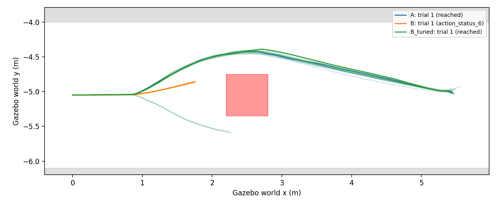
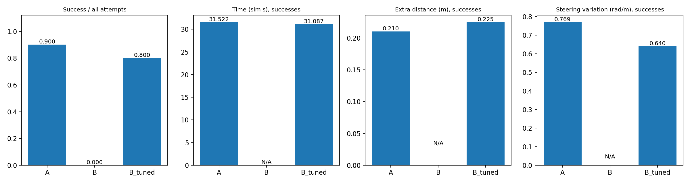

# M3-4 实测分析报告

## 实验与数据口径

ROS2 Humble + Gazebo Classic 11；只读复用 M3-1 车型、M3-2 地图/world 和 M3-3 bringup。每次完整重启全栈，重新定位；本批场景为map目标 (5.5, 0.0, 0.0)（yaw为度），world障碍 (2.5,-5.05)，边长0.6m，请求延迟3.0s，障碍高1m，在接受目标并已有运动后由spawn service生成。实体同时具有 collision 和 visual；原始 /scan 产生障碍层，不向代价地图写数据。两方案仅改变 RPP 前视策略。

成功要求 Nav2 SUCCEEDED、最终 TF 位置误差≤0.20m/航向≤0.40rad、相对初始 map/world 对齐的真值位置误差≤0.30m、未检测到车体与世界方盒相交，并具有延迟2–4秒、路径交叉和激光检测证据。碰撞诊断是原 URDF 0.45×0.22m 车体与 world 方盒的20Hz真值几何相交检查，不是接触力传感器；不保证捕捉采样间的瞬时接触。

长度来自独立 Gazebo 车体真值轨迹，真值仅用于评估。每方案成功无障碍参考路径的均值用于减法；本次参考各1次，因此未估计参考路径方差。耗时从目标接受到终止，主表用仿真秒并附墙钟秒，排除启动、定位与退出时间。成功均值只取成功试次；失败原始行的路程是未完成的部分轨迹，不能解释为有效绕行。

轨迹按0.05m弧长重采样，κ=wrap(Δyaw)/0.05，δ=atan(0.28κ)，平滑度=Σ|Δδ|/总路程（rad/m）。另存 heading_rad_m=Σ|Δyaw|/路程供诊断，两者不可混称。该指标是依据轨迹的等效单轨转角估计，包含物理噪声，未用指令曲线冒充实测转角。

|方案|成功/尝试|成功均耗时 sim s|墙钟 s|绕行额外 m|转向变化 rad/m|
|---|---:|---:|---:|---:|---:|
|A|9/10|31.522|31.674|0.210|0.769|
|B|0/10|N/A（无成功试次）|N/A（无成功试次）|N/A（无成功试次）|N/A（无成功试次）|
|B_tuned|8/10|31.087|31.242|0.225|0.640|

A、B各10次的原始数据见 [benchmark.csv](results/benchmark.csv)。调优后10次的逐次结果见 [tuning_log.md](results/tuning_log.md)，边界实验见 [failure_boundary.md](results/failure_boundary.md)。

## ① 哪种综合更好，代价是什么

按正式成功数优先，A 优于 B，本批成功率相差 90.0 个百分点；具体四指标见上表。若某方案无成功试次，其成功条件下的耗时/绕行/平滑度不可定义，不能用失败后提前停车带来的短耗时或小转角宣称更好。与该方案自身无障碍参考相比，成功均耗时增加 2.122s，路径增加 0.210m，平滑度由 0.344 升为 0.769rad/m。这是避障的时间、路程和转向代价；无障碍参考仅1次，不能据此估计统计显著性。

调优将B的成功数从 0/10 提升为 8/10。与A相比，B_tuned成功数少 1 次；仅比较成功试次，耗时差为 -0.435s、额外路径差 +0.014m、平滑度差 -0.129rad/m。这体现了更平顺的成功轨迹与本批到达可靠性之间的取舍，不能把成功子样本上的改善解释为所有尝试都更快。

## ② 失效条件与触发实验

有限重复只能支持该场景中的观测，不证明任意噪声下必然失败。导航终止状态 6=ABORTED；超时单独记录。

|场景|次数|成功|障碍世界坐标|尺寸 m|实际注入 sim s|终止耗时 sim s|终止原因|
|---|---:|---:|---|---:|---|---|---|
|blocked_1p6|3|0|(2.5,-5.05)|1.6|3.10–3.20|10.90–11.00|action_status_6|
|large_0p8|3|0|(2.5,-5.05)|0.8|3.00–3.20|14.60–15.70|action_status_6|
|near_1p4|3|0|(1.4,-5.05)|0.6|3.10–3.20|8.90–9.00|action_status_6|

与标准条件0.60m、x=2.5m的A方案9/10相比，上述记录给出了可脚本重现的失效触发条件。当前尺寸只采样0.60/0.80/1.60m、距离只采样1.4/2.5m，不构成连续精确阈值搜索；不能声称更小障碍必成功或任意更近位置必失败。

各边界条件的逐次数据和复现命令见 [失效边界实验](results/failure_boundary.md)。

南侧通道几何宽度 2.10m。中心障碍留下的单侧几何宽度=(2.10-size)/2；物理车宽0.22m，导航 footprint 宽0.30m。膨胀半径0.40m是代价衰减带，不能直接当成不可通行硬边界。前进转弯半径≥0.60m，纵向准备距离也影响可行性。

1.60m障碍留下单侧0.25m，小于导航footprint宽0.30m，因此南侧就近绕行不满足配置中的车体净宽；这不证明整个环形地图无解。可能存在更长的全局绕行，超时只表示本配置在90仿真秒预算内未到达。近距离场景检验的是前进转弯准备距离，不能简单归因为障碍面积。

长前视方案的10次实验均以Nav2 ABORTED终止，日志出现碰撞预警及规划失败；尚未测试移动障碍速度边界，不能推断其预测能力。早期试跑还暴露了 scan.max_obstacle_height 默认0.0过滤掉高度0.135m激光点的问题；显式设为2.0后，实测可见障碍进入代价地图并触发碰撞预警。这项修复在正式对照前完成。

按实际轨迹相对障碍中心的最大侧向偏移分组，正式样本观测为：A 北侧 9/9；A 南侧 0/1；B 北侧 0/10；B_tuned 北侧 8/8；B_tuned 南侧 0/2。这是对轨迹的事后诊断，并非随机分配的绕行侧对照；它提示局部可用空间、地图/定位差异与全局路径分支也参与失效，不能把剩余失败只归因于前视距离。原始轨迹均保留在叠加图中。

## ③ 局部失败后有没有全局重规划，延迟多少

观察到 19 个包含 FollowPath→FAILURE 的试次，其中 6 个在失败后再次收到 /plan。首次失败到下一条路径的墙钟延迟范围 0.201–2.350s。

使用 /behavior_tree_log 中 FollowPath 的 FAILURE 作为局部失败判据，随后关联 ComputePathToPose RUNNING 与 /plan 回调。墙钟采用同一采集进程 time.monotonic；sim 由 /clock 回调，约0.1s分辨率。Nav2 还会按1Hz周期规划，所以“失败后有路径”不能证明是失败因果触发，更不等于已经脱困。下表列出观测到局部失败的各次实验。延迟为首次局部失败到下一次规划启动或路径输出的墙钟时间；“未观察到”不按0计算。表中各次最终均未到达目标。

|方案/场景|试次|规划启动延迟 s|路径输出延迟 s|
|---|---:|---:|---:|
|A|7|0.487|0.488|
|B|1|2.070|未观察到|
|B|2|0.042|未观察到|
|B|3|2.117|未观察到|
|B|4|0.049|未观察到|
|B|5|2.178|未观察到|
|B|6|0.049|未观察到|
|B|7|0.009|未观察到|
|B|8|2.069|未观察到|
|B|9|0.098|未观察到|
|B|10|2.159|未观察到|
|B_tuned|7|0.199|0.201|
|B_tuned|10|0.710|0.711|
|large_0p8|1|2.072|0.306|
|large_0p8|2|2.189|2.191|
|large_0p8|3|2.348|2.350|
|near_1p4|1|2.228|未观察到|
|near_1p4|2|2.232|未观察到|
|near_1p4|3|2.209|未观察到|

## ④ 比赛场景的选择与参数

比赛假设为同一地图南侧2.10m通道，障碍约0.60m、在离车足够远的路径中段延迟2–4s出现；不包含迎面高速移动物。把调优方案也纳入后，本批优先选择 **A**：先比较成功数，同成功数时比较成功轨迹平滑度，再比较耗时；该选择只针对本报告数据，不是显著性结论。A：RPP desired_linear_vel=0.22、速度相关前视0.30–0.50m、lookahead_time=1.5；B_tuned：固定lookahead_dist=0.40m。两者碰撞预测1.0s、cost_scaling_dist=0.40、膨胀0.40m；Smac DUBIN 与最终 Twist 限幅半径0.60m。保留碰撞检测和禁止原地旋转/倒车约束。边界场景下应停车并允许任务失败，不能用关闭检测获得好看的到达率。

## 轨迹与过程图

四帧过程截图选自A方案第9次实验，对应时刻及车辆位置如下。

|帧|目标接受后 sim s|最近真值 world x,y|
|---|---:|---|
|01_approach|1.00|(0.132,-5.048)|
|02_detected|3.30|(0.649,-5.041)|
|03_detour|7.10|(1.371,-4.749)|
|04_passed|17.70|(3.202,-4.540)|

## 无障碍参考

每套参数各运行一次，目标同为map(5.5,0,0°)。

|方案|导航耗时 sim s|路径长度 m|平滑度 rad/m|
|---|---:|---:|---:|
|A|29.400|5.449540|0.344441|
|B|29.300|5.453447|0.044283|
|B_tuned|29.300|5.430812|0.235216|
