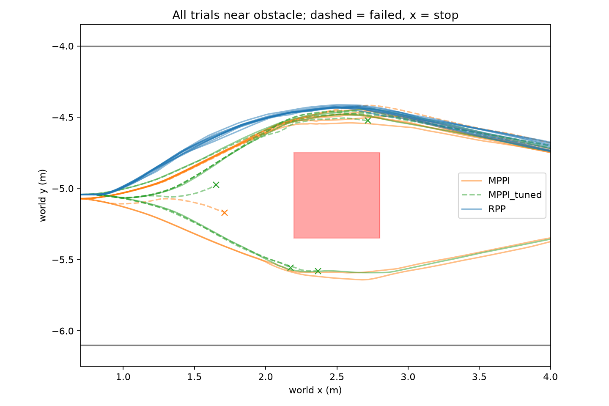
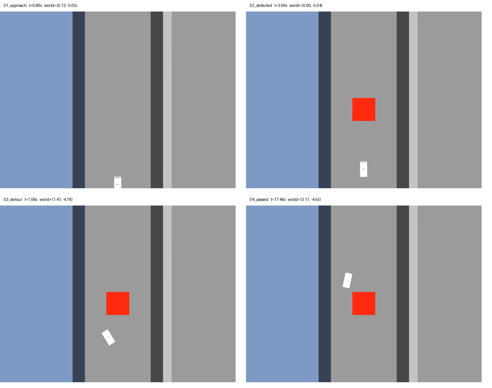

# RPP 与 MPPI：实测分析

共同条件：最大速度0.22 m/s，最小转弯半径0.60 m，footprint 0.50×0.30 m，膨胀半径0.40 m，Smac Hybrid-A*（DUBIN），1Hz行为树重规划；禁止倒车和原地旋转。默认目标 map(5.5,0,0°)，world障碍(2.5,-5.05)，边长0.60 m，高1 m，目标接受后3秒生成。

实体有 collision 和 visual，通过激光进入两张代价地图；不直接写代价地图。真值仅用于评估。成功须动作 SUCCEEDED、TF位置误差≤0.20 m/朝向≤0.40 rad、真值位置误差≤0.30 m、未发现几何碰撞且有有效延迟/路径交叉/激光检测证据。20Hz矩形相交检测不等同于接触力传感器。

长度为Gazebo真值轨迹积分；平滑度按0.05m弧长重采样，κ=Δyaw/Δs，δ=atan(0.28κ)，Σ|Δδ|/总路程。它是等效单轨转角估计，另存实测 steering_joints 供诊断。耗时、额外路径、平滑度均值只取成功试次；失败全部保留，不能用失败部分轨迹冒充有效绕行。各规划器采用自身无障碍基线均值。

|方案|成功/尝试|耗时 sim s|额外路径 m|转角变化 rad/m|
|---|---:|---:|---:|---:|
|MPPI|8/10|33.663|0.160|0.644|
|MPPI_tuned|3/10|33.200|0.212|0.597|
|RPP|10/10|31.420|0.196|0.751|

## ① 哪种表现更好

按成功数优先、相同时成功平均耗时的预定规则，本批排序为 RPP、MPPI。成功数分别为10/10和8/10；四项指标见表。RPP减MPPI的成功平均耗时差为-2.242s、额外路径差+0.036m、平滑度差+0.107rad/m。每种仅10次，成功子样本构成可能不同，不宣称统计显著或所有场景普遍优越。

|方案|优化失败日志条数|全局规划失败日志条数|控制周期超时日志条数|FollowPath失败事件数|
|---|---:|---:|---:|---:|
|MPPI|21|17|9|23|
|MPPI_tuned|25|19|257|24|
|RPP|0|0|0|0|

超时试次的终止路程（未完成轨迹，不能作为有效绕行）：MPPI/6：14.235m/90.0s；MPPI_tuned/1：15.841m/90.0s；MPPI_tuned/4：15.813m/90.0s。应结合全局路径及停止位置区分局部卡住与全局长路超时，不仅凭超时标签推断原因。

终点复核不通过的试次也计失败。定位估计、全局路径分支与控制动作可能相互影响；共享AMCL配置并不等于排除了定位误差，本实验不将所有失败都归因为局部控制器本身。

RPP以路径跟踪、调速与碰撞检测为主；MPPI采样阿克曼可行轨迹并评分。两者共同使用动态全局代价地图和Smac，故比较的是相同导航栈下控制器替换的整体效果，不能将全局绕行完全归因于局部控制器。

## ② 什么情况下失效

|场景|规划器|成功/次数|world x,y|尺寸 m|延迟 s|原因|
|---|---|---:|---|---:|---:|---|
|blocked_1p6|MPPI|0/3|2.5,-5.05|1.6|3.0|{'action_status_6': 3}|
|blocked_1p6|RPP|0/3|2.5,-5.05|1.6|3.0|{'action_status_6': 3}|
|large_0p8|MPPI|0/3|2.5,-5.05|0.8|3.0|{'action_status_6': 3}|
|large_0p8|RPP|0/3|2.5,-5.05|0.8|3.0|{'action_status_6': 3}|
|near_1p4|MPPI|0/3|1.4,-5.05|0.6|3.0|{'action_status_6': 3}|
|near_1p4|RPP|0/3|1.4,-5.05|0.6|3.0|{'action_status_6': 3}|

有限重复只说明采样条件下的观测；0/3不是数学意义的必然失败。2.10m通道中1.60m中心障碍单侧净宽0.25m小于导航footprint宽0.30m，但这并不证明整张环形地图无解。膨胀半径是代价衰减带，不能直接作为硬净宽。没有测试移动障碍速度边界。

## ③ 局部失败后是否重规划

正式对照、调优及边界实验中，29次观察到 FollowPath→FAILURE，其中23次之后收到 /plan。首次失败到下一条路径回调的墙钟延迟为0.082～2.517s。以 /behavior_tree_log 和 /plan 的同进程 monotonic 时钟关联；周期规划与失败后恢复可能重叠，这只是时间关联，不证明因果。没有后续路径时记null而非0；最终成功状态见下表。

|方案/次|规划启动延迟 s|路径输出延迟 s|最终到达|
|---|---:|---:|---|
|standard/MPPI/1|0.530|0.534|1|
|standard/MPPI/2|0.341|0.343|1|
|standard/MPPI/3|2.070|0.412|1|
|standard/MPPI/4|0.609|1.204|1|
|standard/MPPI/5|0.700|0.702|1|
|standard/MPPI/6|2.189|2.191|0|
|standard/MPPI/7|0.080|0.082|1|
|standard/MPPI/8|0.890|0.892|1|
|standard/MPPI/10|2.062|2.063|1|
|standard/MPPI_tuned/1|0.642|0.644|0|
|standard/MPPI_tuned/2|2.072|0.381|0|
|standard/MPPI_tuned/3|0.921|0.924|1|
|standard/MPPI_tuned/4|0.513|0.515|0|
|standard/MPPI_tuned/5|0.721|0.723|0|
|standard/MPPI_tuned/6|0.239|0.900|0|
|standard/MPPI_tuned/8|2.149|2.151|0|
|standard/MPPI_tuned/9|0.329|0.331|1|
|large_0p8/RPP/1|2.223|2.223|0|
|large_0p8/MPPI/1|0.377|0.982|0|
|large_0p8/MPPI/2|0.944|0.944|0|
|large_0p8/RPP/2|2.309|2.517|0|
|large_0p8/RPP/3|2.247|2.250|0|
|large_0p8/MPPI/3|0.880|0.885|0|
|near_1p4/RPP/1|2.198|N/A|0|
|near_1p4/MPPI/1|0.718|N/A|0|
|near_1p4/MPPI/2|0.670|N/A|0|
|near_1p4/RPP/2|2.193|N/A|0|
|near_1p4/RPP/3|2.160|N/A|0|
|near_1p4/MPPI/3|0.719|N/A|0|

## ④ 比赛选择与具体参数

在本批低速、2.10m通道、突现静止障碍场景中，按成功率优先、同率比较耗时的规则暂选 RPP：成功10/10，成功均耗时31.420s、额外路径0.196m、转角变化0.751rad/m。具体控制参数：desired_linear_vel=0.22，use_velocity_scaled_lookahead_dist=True，min/max_lookahead_dist=0.3/0.5m，lookahead_time=1.5s，max_allowed_time_to_collision_up_to_carrot=1.0s。完整冻结参数见本目录 config/（A=planner_a_params.yaml，B=planner_b_params.yaml），不将这一选择外推到高速移动物场景。无解或超预算时停车并记录失败，不能关闭碰撞检测换成功率。

## 参数调优

初始正式批次RPP为10/10、MPPI为8/10，选择MPPI调优。第一轮只延长时域得到7/10，未改善。第二轮回到原4秒时域，仅相对原始MPPI将batch_size从1500增加到3000；用更多候选轨迹检验能否减少求解失败，计算负担可能上升。第一轮完整数据见 results/tuning_log.md。

|参数|冻结原值|新值|假设|
|---|---:|---:|---|
|FollowPath.time_steps|120|80|撤回第一轮未改善总体表现的时域变化，回到原MPPI的4秒预测时域。|
|FollowPath.batch_size|1500|3000|第二轮相对原始MPPI唯一变化：增加候选轨迹数，检验是否能减少可行轨迹采样不足造成的求解失败；不预设成功率一定提高。|

原值为本实验冻结配置，不冒称上游默认值。每轮只改表中参数，其余全栈保持一致。

|方案|成功/尝试|耗时 sim s|额外路径 m|转角变化 rad/m|
|---|---:|---:|---:|---:|
|MPPI|8/10|33.663|0.160|0.644|
|MPPI_tuned|3/10|33.200|0.212|0.597|
|RPP|10/10|31.420|0.196|0.751|

成功数变化：8/10 → 3/10。
nav_sim_s：33.663 → 33.200，变化-0.462。
extra_path_m：0.160 → 0.212，变化+0.052。
smoothness_rad_m：0.644 → 0.597，变化-0.046。

本轮成功率低于原MPPI，不采纳这套参数作为改进配置。

## 第一轮未改善的调优记录

第一轮只把 time_steps 80→120，成功数为7/10，低于原MPPI的8/10。主表与主图中的 MPPI_tuned 为第二轮最终配置；第一轮CSV、完整基线、配置和图表均保留，见 [逐轮调优记录](results/tuning_log.md)，不混入第二轮均值。
## 可视化

## 无障碍参考

|规划器|尝试|成功|平均路径 m|
|---|---:|---:|---:|
|MPPI|3|3|5.459|
|MPPI_tuned|3|3|5.439|
|RPP|3|3|5.436|

## 独立俯视演示

以下为同配置额外演示试次的真实Gazebo俯视相机帧，不计入上述成功率。原始相机帧与时间记录保存在交付目录外的证据备份。

